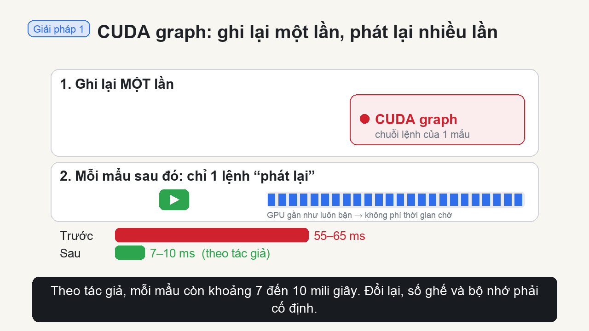
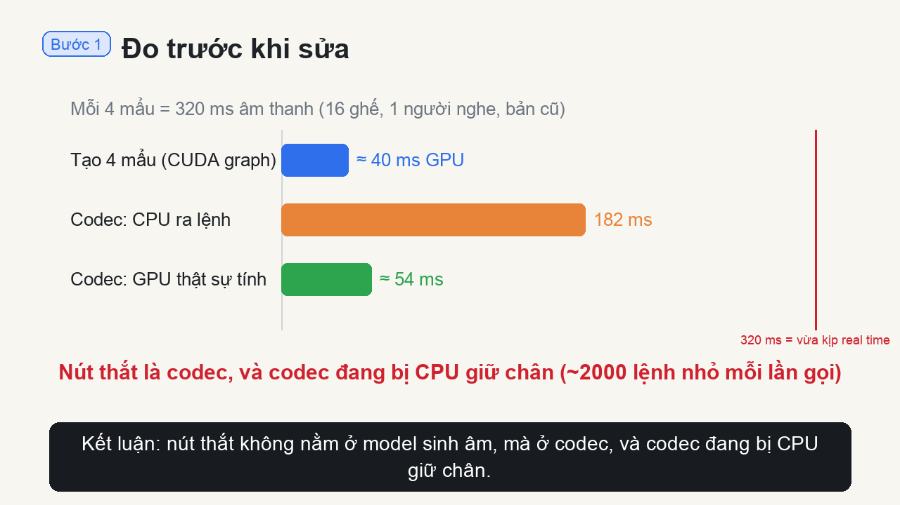

# VieNeu-TTS inference

[VieNeu-TTS](https://github.com/pnnbao97/VieNeu-TTS) v3 Turbo đọc tiếng Việt theo thời gian thực: gửi một đoạn văn,
khoảng 130 ms sau đã có tiếng, phần còn lại phát tiếp trong lúc model vẫn đang tạo. Model này khá nhỏ. Thứ làm nó
nhanh là cách server chạy model.

Repo này kể lại hai giai đoạn làm việc với server đó. Mọi thứ chạy trên GPU thuê theo giờ qua
[VKong](https://vkong.tli-tech.com), do AI agent điều khiển từ đầu đến cuối: thuê máy, deploy, sửa lỗi, đo, tải kết
quả về, rồi trả máy.

## Câu chuyện

**Giai đoạn 1: hiểu và tạo bản lite (13/10/2026).** Mình dùng agent đọc code của tác giả để hiểu vì sao nó nhanh,
rồi cho agent dựng một bản gọn từ chính code đó, gọi là lite. Đo trên cùng một GPU thì lite chạy ngang SDK gốc, không
nhanh hơn. Tốc độ nằm ở thiết kế của tác giả; bản lite chỉ giúp code dễ đọc hơn. Chi tiết: [PHASE1.md](PHASE1.md).

**Giai đoạn 2: đo rồi mới sửa (14–15/10/2026).** Lần này mình không đoán nữa. Gắn profiler và đo trên GPU thật thì
thấy phần tạo âm thanh đã nhanh, còn chỗ chậm là codec: mỗi lần gọi, CPU mất 182 ms để ra lệnh trong khi GPU chỉ cần
54 ms để tính. Sửa đúng chỗ đó, không đụng vào model, và lite xử lý nhanh gần gấp 3 lần SDK gốc. Chi tiết:
[OPTIMIZATION.md](OPTIMIZATION.md).

| Giai đoạn 1: VieNeu hoạt động thế nào | Giai đoạn 2: tối ưu codec |
|---|---|
| [](docs/how-it-works.mp4) | [](docs/optimize.mp4) |

*Giọng đọc trong cả hai video do chính bản lite tạo ra.*

## Kết quả

Bản lite đã tối ưu so với SDK gốc của tác giả, đo trên cùng một máy RTX 3060 12 GB (16/10/2026):

| Người dùng cùng lúc | TTFA P50 / P90, SDK gốc | TTFA P50 / P90, bản tối ưu | RTF P50 / P90, SDK gốc | RTF P50 / P90, bản tối ưu |
|---:|---:|---:|---:|---:|
| 1 | 110.1 / 110.8 ms | **62.7 / 63.4 ms** | 0.476 / 0.480 | **0.162 / 0.167** |
| 4 | 151.2 / 152.5 ms | **116.0 / 120.9 ms** | 0.510 / 0.525 | **0.184 / 0.191** |
| 8 | 177.0 / 186.7 ms | **143.1 / 154.5 ms** | 0.533 / 0.548 | **0.196 / 0.202** |
| 16 | 205.3 / 343.8 ms | 210.9 / **226.2 ms** | 0.591 / 0.607 | **0.217 / 0.224** |
| 32 (32 ghế) | 494.9 / 672.5 ms | **411.6 / 458.5 ms** | 0.918 / 0.955 | **0.347 / 0.364** |

TTFA là thời gian tới khi nghe được tiếng đầu tiên. RTF là thời gian xử lý chia cho độ dài âm thanh: dưới 1 thì người
nghe không bị ngắt, càng nhỏ càng nhanh.

- **RTF giảm 2.6–2.9 lần** ở mọi mức tải. Tiếng đầu với 1 người dùng: 110 → 63 ms.
- **Âm thanh không đổi.** Nghe thử cùng một câu, cùng seed: [trước](docs/samples/original-1.wav) và
  [sau](docs/samples/optimized-1.wav) khi tối ưu. Đủ 5 câu ở [docs/samples/](docs/samples/).
- **Ổn định khi tải lớn.** Với 32 ghế và 32 người dùng liên tục trong 3 phút: 1824 request, không lỗi nào.

Cách đo, máy đo và profile trước/sau tối ưu: [OPTIMIZATION.md](OPTIMIZATION.md).

## Codec: trước và sau tối ưu

Codec đổi các con số model tạo ra thành sóng âm. Mỗi lần gọi, nó nhận 4 mẩu (320 ms âm thanh) của mọi người dùng
cùng lúc. Đây là phần chậm nhất của server trước khi tối ưu.

Thời gian một lần gọi codec, với 1 người dùng (số từ profiler):

| | CPU | GPU |
|---|---|---|
| Trước | ████████████████████ 182 ms | ████████████████████ 183 ms |
| Sau | ▏ 1.2 ms | ██▍ 22 ms |

### Trước: giải mã từng mẩu một

Codec của SDK chạy hết 12 lớp transformer cho mẩu 1, đợi GPU xong, rồi mới tới mẩu 2:

```
một lần gọi = 4 vòng lặp:

  mẩu 1 → 12 lớp transformer → đợi GPU (.item) ┐
  mẩu 2 → 12 lớp transformer → đợi GPU (.item) ┤  ~830 lệnh launch mỗi mẩu:
  mẩu 3 → 12 lớp transformer → đợi GPU (.item) ┤  CPU ra lệnh liên tục, GPU ngồi chờ
  mẩu 4 → 12 lớp transformer → đợi GPU (.item) ┘
```

- Chi phí tăng theo số mẩu: lần gọi 4 mẩu tốn gần gấp đôi lần gọi 2 mẩu (155 ms so với 91 ms CPU). Gom 4 mẩu vào một
  lần gọi gần như không làm rẻ hơn.
- Ở mỗi lớp, mỗi mẩu, KV cache (key/value của 4–10 giây trước đó) bị chép lại cả cửa sổ 4 lần, chỉ để thêm 1 bước mới:

```
cache cũ :  [k1 k2 k3 … kN]
cat      :  [k1 k2 k3 … kN k+]     ← chép cả cửa sổ, lần 1
cắt      :  [k2 k3 … kN k+]        ← lần 2
where    :  …                      ← lần 3
copy_    :  ghi vào cache          ← lần 4
```

### Sau: một lượt cho 4 mẩu, một lệnh, KV dạng vòng

Ba thay đổi, model giữ nguyên:

```
một lần gọi:

  4 mẩu ──→ 12 lớp, tính một lượt cho cả 4 mẩu ──→ âm thanh 4 × 80 ms
            (mask nhân quả: mỗi mẩu chỉ nhìn các mẩu trước nó)
            cả chuỗi lệnh là một CUDA graph: CPU chỉ gửi 1 lệnh
```

1. **Gom 4 mẩu vào một lượt.** Codec không tự hồi quy: các con số của cả 4 mẩu đã có sẵn từ model, nên tính một lượt
   cho kết quả như tính 4 lượt, giống prefill của LLM.
2. **CUDA graph.** Ghi lại chuỗi lệnh một lần, mỗi lần gọi chỉ phát lại. CPU gần như rảnh.
3. **KV cache dạng vòng.** Một mảng cố định đủ chứa cửa sổ cộng 4 mẩu. Bước thứ `p` nằm ở ô `p mod C`, bước mới ghi đè
   ô của bước cũ nhất đã ra khỏi cửa sổ:

```
mảng C = 8 ô, đang chứa các bước k2 … k9:

ô   :   0     1     2     3     4     5     6     7
      [k8]  [k9]  [k2]  [k3]  [k4]  [k5]  [k6]  [k7]
                    ↑
                    bước mới k10 ghi đè đúng ô này (10 mod 8 = 2), không chép gì thêm
```

Khi làm attention, thứ tự các bước được tính lại từ số thứ tự bước, nên cho cùng kết quả với cache cũ.

**Âm thanh không đổi:** codec mới được so với codec gốc mỗi lần server khởi động, tương quan 0.9999992. Mỗi thay đổi
đóng góp bao nhiêu: xem [bước 7 trong OPTIMIZATION.md](OPTIMIZATION.md#bước-7-đo-từng-phần-ablation).

## Chạy thử

Cần CLI của VKong đã đăng nhập. Bước 1 thuê máy, cài thư viện và chạy server:

```bash
cd lite                              # hoặc baseline
vkong validate                       # kiểm tra vkong.yaml
vkong run                            # thuê RTX 3060 12 GB, cài thư viện, chạy serve.py
```

Đợi dòng `Workload running · http://127.0.0.1:PORT`. Đó là địa chỉ của server trên máy bạn. Ở một terminal khác:

```bash
SERVE_URL=http://127.0.0.1:PORT
curl "$SERVE_URL/health"
curl "$SERVE_URL/v1/audio/speech" \
  -H 'Content-Type: application/json' \
  -d '{"input":"Xin chào.","response_format":"pcm"}' \
  --output speech.pcm                # PCM 16-bit, mono, 48 kHz
```

Sửa code xong thì đẩy lên máy đang thuê, không cần thuê lại. Dùng xong nhớ trả máy, vì `Ctrl+C` chỉ ngắt kết nối và
máy vẫn tính tiền:

```bash
vkong instances                      # lấy <instance-id>, dạng vk_...
vkong attach <instance-id> --update
vkong app stop vieneu-serving-lite   # bản baseline: vieneu-original-baseline
```

`lite/vkong.yaml` đang bật sẵn các cờ dùng để đo (`PROFILE=1 BENCH_MODE=1 CODEC_VERIFY=1`). Khi chạy thật thì bỏ ba cờ
này. Các cờ thường dùng của `serve.py`:

| Cờ | Mặc định | Ý nghĩa |
|---|---|---|
| `MAX_STREAMS` | 16 | Số ghế, tức số người được tạo âm thanh cùng lúc. Người thứ 17 phải xếp hàng |
| `OVERLAP_CODEC` | 1 | Codec chạy song song với model. `0` để chạy tuần tự |
| `CODEC_GRAPHS`, `CODEC_RING` | 1, 1 | Hai phần tối ưu của codec. `0` để tắt từng phần |
| `PROFILE` | 0 | Bật profiler: `/profile`, `/profile/trace` (xem OPTIMIZATION.md) |
| `BENCH_MODE` | 0 | Mở `/benchmark` và `/stress` để đo ngay trên máy GPU |
| `WATERMARK` | 1 | Dấu ẩn đánh dấu giọng AI. Các phép đo đều tắt |

Những điều cần biết khi đo trên VKong (tunnel hay đứt, chốt giá trước khi thuê…) nằm ở cuối
[OPTIMIZATION.md](OPTIMIZATION.md#ghi-chú-khi-làm-với-vkong).

## Trong repo

| Đường dẫn | Nội dung |
|---|---|
| [baseline/](baseline/) | SDK gốc của tác giả, bọc thêm HTTP |
| [lite/vieneu_lite/frame.py](lite/vieneu_lite/frame.py) | CUDA graph tạo một mẩu 80 ms cho mọi ghế |
| [lite/vieneu_lite/scheduler.py](lite/vieneu_lite/scheduler.py) | Chia ghế, nạp câu, chạy graph, gọi codec |
| [lite/vieneu_lite/codec.py](lite/vieneu_lite/codec.py) | Codec đã tối ưu (giai đoạn 2) |
| [lite/vieneu_lite/tts.py](lite/vieneu_lite/tts.py) | Cắt câu, phoneme, khoảng nghỉ |
| [lite/vieneu_lite/profiler.py](lite/vieneu_lite/profiler.py) | Profiler, bật bằng `PROFILE=1` |
| [lite/serve.py](lite/serve.py), [lite/benchmark.py](lite/benchmark.py), [lite/stress.py](lite/stress.py) | Server HTTP, client benchmark, bài thử tải và chất lượng |
| [baseline/results/](baseline/results/), [lite/results/](lite/results/) | Số đo gốc của mọi lần chạy; thí nghiệm nào đo cả hai bản thì hai bên cùng cấu trúc |
| [experiments/phase1/](experiments/phase1/) | Tính lại bảng, dựng lại đúng code đã đo và chạy lại giai đoạn 1 (xem [PHASE1.md](PHASE1.md#tự-kiểm-tra-và-chạy-lại)) |
| [docs/](docs/) | Hai video, mẫu nghe, ảnh chụp VKong |
