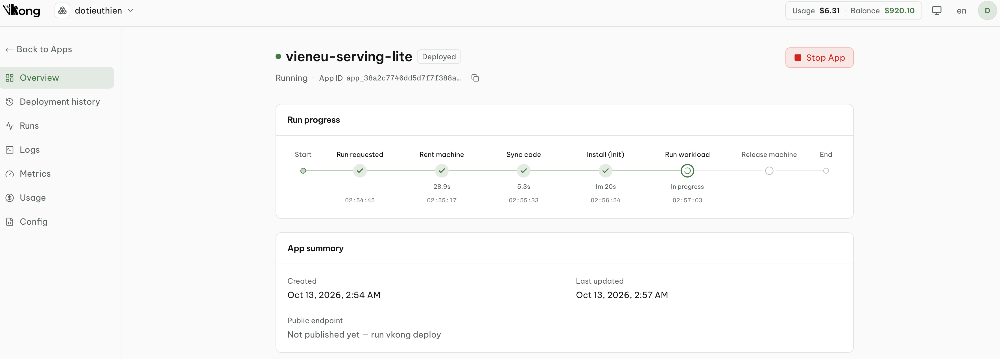
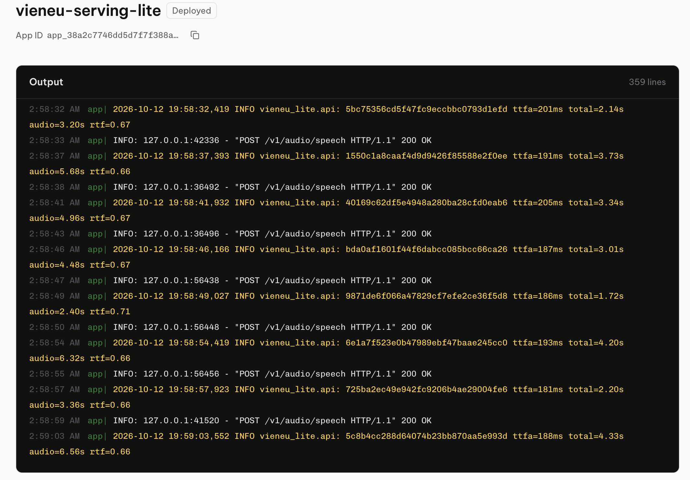
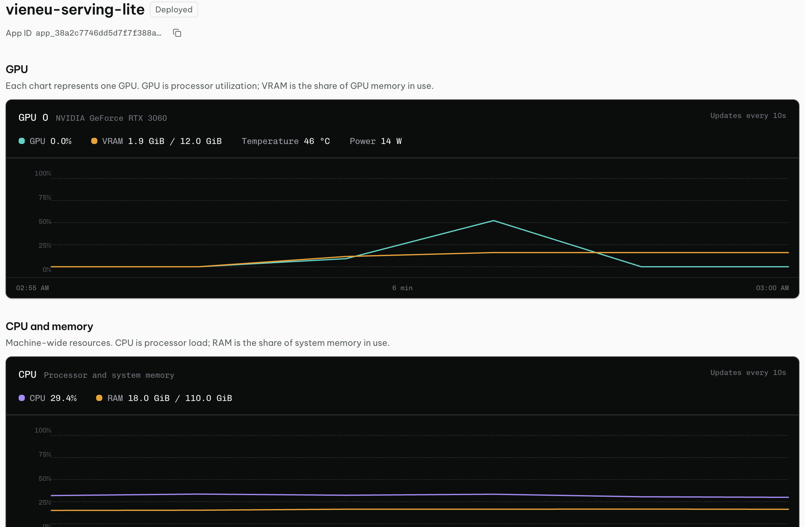

# VieNeu-TTS inference

[VieNeu-TTS](https://github.com/pnnbao97/VieNeu-TTS) v3 Turbo là model đọc tiếng Việt chạy được thời gian thực:
gửi một đoạn văn, khoảng 130 ms sau đã nghe được tiếng đầu tiên, phần còn lại được stream tiếp trong lúc model
vẫn đang tạo. Tốc độ đó không nằm ở bản thân model (khá nhỏ), mà ở cách server chạy nó: CUDA graph,
nhiều người dùng chung một lần chạy GPU, và codec giải mã từng đoạn ngắn.

Repo này ghi lại quá trình tìm hiểu phần đó:

1. **Đọc hiểu** đường inference của upstream: model sinh âm thanh thế nào, vì sao cần CUDA graph, scheduler chia GPU cho nhiều request ra sao.
2. **Viết lại một bản đơn giản** (lite) chỉ giữ đường streaming trên GPU, đủ nhỏ để đọc hết trong một buổi.
3. **Chạy thật trên GPU thuê qua [VKong](https://vkong.tli-tech.com)**, do AI agent điều khiển: deploy, fix bugs, gọi API, benchmark, tải log và trả máy.
4. **So sánh** bản lite với SDK gốc bằng cùng một client benchmark.

## VieNeu hoạt động như thế nào?

[](docs/how-it-works.mp4)

*Giọng đọc trong video được tạo bằng chính bản lite.*

## Hai bản trong repo

- **[baseline](baseline/)**: gọi SDK VieNeu nguyên bản (`Vieneu(...).infer_stream()`), thêm wrapper HTTP có semaphore giới hạn số stream.
- **[lite](lite/)**: viết lại phần streaming trên GPU; vẫn dùng SDK để load model, codec, phonemizer và giọng preset.

Bản lite gói toàn bộ đường serving trong ba file:

| File | Việc |
|---|---|
| [frame.py](lite/vieneu_lite/frame.py) | Một CUDA graph cho mỗi mẩu 80 ms: chọn 16 mã, chống lặp, sampling theo từng request, KV cache cấp phát sẵn |
| [scheduler.py](lite/vieneu_lite/scheduler.py) | 16 slot dùng chung GPU: nhận request, prefill, chạy graph, gom 4 mẩu rồi gọi codec |
| [tts.py](lite/vieneu_lite/tts.py) | Cắt văn bản thành câu, đổi sang phoneme, nối các câu với khoảng nghỉ đúng |

So với SDK gốc, lite bỏ các đường không dùng cho GPU streaming (CPU/ONNX, GGUF, static batch, Gradio) và thêm vài chốt an toàn:
tham số sampling sai bị từ chối trước khi vào GPU, lỗi của một request không làm chết server, `/health` trả 503 khi worker chết.
Cờ `OVERLAP_CODEC=1` (mặc định) cho codec chạy song song với việc tạo mẩu; `OVERLAP_CODEC=0` chạy tuần tự như SDK gốc.

## Chạy trên VKong cùng agent

VKong cho thuê GPU theo giờ và điều khiển hoàn toàn bằng CLI, nên agent tự làm được cả vòng:
viết code → `vkong run` → gọi API qua tunnel localhost → chạy benchmark ngay trên máy GPU → tải log về → `vkong app stop`.
Con người chỉ cần đọc kết quả và quyết định bước tiếp theo. Một RTX 3060 có giá khoảng $0.06–0.08/giờ.

```bash
cd lite                                # hoặc: cd baseline
vkong validate && vkong run            # thuê RTX 3060, cài thư viện, chạy serve.py
SERVE_URL=http://127.0.0.1:PORT        # PORT lấy từ URL VKong in ra
curl "$SERVE_URL/health"
curl "$SERVE_URL/v1/audio/speech" -H 'Content-Type: application/json' \
  -d '{"input":"Xin chào.","response_format":"pcm"}' --output speech.pcm   # PCM 16-bit, mono, 48 kHz
vkong attach <instance-id> --update    # sau khi sửa code
vkong app stop vieneu-serving-lite     # trả máy; baseline: vieneu-original-baseline
```

`Ctrl+C` chỉ ngắt kết nối; máy vẫn tính tiền đến khi chạy `vkong app stop`.

Ảnh chụp từ dashboard VKong trong lần chạy đó:



*Tiến trình chạy: thuê máy 29 giây, đồng bộ code 5 giây, cài thư viện 1 phút 20 giây rồi chạy server.*



*Log server: mỗi câu lời thoại là một request, gửi lần lượt từng câu. Audio đầu tiên ra sau 181–205 ms (đo phía server), RTF 0.66–0.71.*



*Tài nguyên: RTX 3060 dùng tối đa khoảng 50%, VRAM 1,9 / 12 GiB.*

## Kết quả (RTX 3060, 13/10/2026)

**TTFA**: thời gian từ lúc gửi yêu cầu đến khi nhận audio đầu tiên (ms). **RTF**: tổng thời gian ÷ độ dài audio.
Cả hai càng thấp càng tốt. Số trong bảng là p50 tính trên từng request.

**Lite (trước khi có overlap) so với baseline**: đo theo thứ tự A–B–B–A, 630 request mỗi bản.

| Request đồng thời | TTFA baseline | TTFA lite | RTF baseline | RTF lite |
|---:|---:|---:|---:|---:|
| 1 | 127.0 | 129.1 | 0.529 | 0.548 |
| 4 | 174.4 | 173.6 | 0.568 | 0.568 |
| 8 | 202.6 | 202.5 | 0.591 | 0.590 |
| 16 | 243.6 | 273.8 | 0.674 | 0.659 |
| 32 (32 slot) | 588.4 | 591.5 | 1.040 | 1.039 |

**Overlap codec**: phép thử nhỏ, mỗi cấu hình 6 request ở mức 1 và 32 request ở mức 16.

| Request đồng thời | Cấu hình | TTFA | RTF |
|---:|---|---:|---:|
| 1 | Baseline | 131.1 | 0.535 |
| 1 | Lite, `OVERLAP_CODEC=0` | 131.7 | 0.552 |
| 1 | Lite, `OVERLAP_CODEC=1` | 151.0 | 0.497 |
| 16 | Baseline | 272.9 | 0.730 |
| 16 | Lite, `OVERLAP_CODEC=0` | 233.9 | 0.680 |
| 16 | Lite, `OVERLAP_CODEC=1` | 319.4 | 0.652 |

**Rút ra:**

- Lite chạy xấp xỉ SDK gốc, không nhanh hơn: phần làm nên tốc độ là thiết kế của tác giả VieNeu, lite chỉ viết lại cho dễ đọc.
- Codec song song: cả câu xong sớm hơn chút nhưng tiếng đầu đến chậm hơn; mẫu còn nhỏ.

Điều kiện chung: client chạy ngay trên máy GPU (không tính tunnel); 16 slot, K=4, leadin=2; tắt watermark
(dấu ẩn đánh dấu giọng AI) ở cả hai bản. Mọi request đọc cùng một câu bằng giọng mặc định Hải Đăng:

> Xin chào, đây là giọng đọc VieNeu phát trực tiếp qua API chuẩn OpenAI.

Đây là câu mặc định của client benchmark upstream, dài khoảng 4 giây audio. Kết quả vì vậy chỉ phản ánh
câu ngắn gửi dồn cùng lúc; văn bản dài nhiều câu hoặc request đến rải rác chưa được đo.